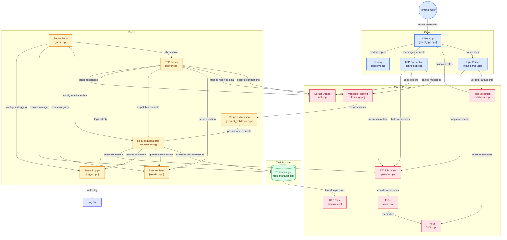

# Shared Task Coordination Service (STCS) - Phase 3

## Link-to-Repo: **https://github.com/Sai-Praneeth-b/STCS**

## Project name and purpose

The **Shared Task Coordination Service (STCS)** is a TCP client-server
application written in C++17 for small teams that share one task list. Users
can create tasks, list them, claim work, release it, mark it done and delete
tasks. The main goal is that two users can never both claim the same open
task: the server owns the task list and decides every conflict (the first
claim wins, the other client gets a `CONFLICT` reply). Phase 3 is the final
version: **many clients connect to one server at the same time.**
Course: CIS 527 - Computer Networks.

## Team members

This is an individual project: **Sai Praneeth Bhattu** (protocol design,
implementation, tests, documentation).

## System Architecture



**Phase 3 (this deliverable) is multiple clients + one server.** The server
runs one thread per connected client and protects all shared data with locks.
The client program and the wire protocol are unchanged from Phase 2.

## Features

* TCP sockets only (`socket`, `bind`, `listen`, `accept`, `connect`, `send`,
  `recv`, `close`), no HTTP or networking framework.
* Newline-delimited JSON protocol (the Phase 1 "STCS v1" protocol), with a
  framing layer that handles partial reads, several messages in one read, and
  a message plus a trailing fragment. No `sleep()` or timing assumptions.
* All nine Phase 1 commands: `HELLO`, `HELP`, `LIST_TASKS`, `CREATE_TASK`,
  `CLAIM_TASK`, `RELEASE_TASK`, `COMPLETE_TASK`, `DELETE_TASK`, `QUIT`.
* Session state machine (`CONNECTED`, `READY`, `CLOSING`, `CLOSED`).
* Structured success and error responses with the 12 Phase 1 error codes.
* Timestamped server log (`logs/server.log`), graceful and abrupt disconnect
  handling, clean shutdown on Ctrl-C / SIGTERM.
* Plain-text client interface, within 80 columns.
* **Phase 3:** many simultaneous clients (tested with 100), one thread per
  client, unique session id per connection, shared task list protected by a
  mutex, atomic conflict handling (two clients claiming one task: one wins,
  the other gets `CONFLICT`), a client crash or bad request affects only its
  own session, session resources freed on exit, thread-safe log, and graceful
  shutdown that closes every session and joins every thread.

## Architecture summary

```
shared/   utf8, json, framing, protocol, validation, net, timeutil   (both programs)
          (unchanged in Phase 3)
server/   logger, session, task_manager, request_validation,
          dispatcher, server (TCP listener + session loop), main
client/   connection, input_parser, display, client_app, main
tests/    test_framing, test_units, test_integration,
          test_concurrency (Phase 3), load_test (Phase 3), run_all.sh
docs/     Phase 3 report (STCS_Phase3_Final_Report.docx), protocol overview
          (STCS Phases Info.md), protocol-examples.json, diagrams/,
          client-ana.txt, client-ben.txt, client-cara.txt,
          sample-server.log, test-results.txt
logs/     sample-server.log (copy of docs/sample-server.log); the server and the
          tests write their own log files here at run time
```

Concurrency model (Phase 3): the main thread only runs `poll()` + `accept()`
and starts one `std::thread` per client (`Server::serve_client`). Each thread
owns its `ClientSession` (socket, framer buffer, state), so nothing
per-client is shared. Shared objects and their locks:

| Shared object | Lock | Why |
|---|---|---|
| `TaskManager` (task table, id counter) | one mutex, held for each whole operation | check-then-change (e.g. claim) is atomic |
| `SessionRegistry` (session ids, display names) | one mutex | unique ids; two equal `HELLO` names cannot both win |
| `Logger` (log file + console) | one mutex | one log line at a time, never interleaved |

No code ever holds two of these locks at once (the dispatcher calls them one
after another), so deadlock is not possible. Shutdown uses a self-pipe: SIGINT
or SIGTERM writes a byte that every session thread and the accept loop
`poll()` on.

Request path on the server:
`recv()` -> `MessageFramer` -> envelope + payload validation ->
`RequestDispatcher` -> `TaskManager` (in-memory task store) -> response ->
`send_all()`; every step is logged by `Logger`.
See `docs/STCS_Phase3_Final_Report.docx` section 2 (and `docs/diagrams/`) for diagrams.

## Required software

* Linux or macOS, a C++17 compiler (`g++` 7+ or `clang++`) with pthreads,
  and `make`.
* No third-party libraries. (Python 3 is *not* needed.)
* Developed and tested with g++ 13.3 on Linux 6.x. No server port limit other
than the operating system's open-file and thread limits.

## Build instructions

From the project root:

```
make            # builds bin/server and bin/client
make tests      # builds the test programs in build/
make check      # builds everything and runs ALL tests
make clean      # removes build products, binaries and logs
```

(The binaries are in `bin/` because the source directories are already named
`server/` and `client/`.)

## Server startup instructions

```
./bin/server <port> [log_file]
./bin/server 5050
```

## Client startup instructions

```
./bin/client <host> <port> <display_name>
./bin/client 127.0.0.1 5050 Ana
```

## Command-line arguments

| Program | Argument | Meaning |
|---|---|---|
| server | `port` | TCP port to listen on, 1-65535 (required) |
| server | `log_file` | log path (optional; default `logs/server.log`, relative to the current directory; the `logs/` directory is created if missing) |
| client | `host` | hostname or IPv4 address of the server |
| client | `port` | server port, 1-65535 (validated before any connection is attempted) |
| client | `display_name` | 1-24 characters: letters, digits, space, `_`, `-`, `.`; quote it if it has spaces |

Exit codes: `0` normal; `1` runtime failure (cannot connect, connection lost,
cannot bind); `2` bad command-line arguments.

## Example interaction

The timestamps below are illustrative.

Terminal 1:

```
$ ./bin/server 5050
2026-10-30T15:01:17Z INFO Server starting (STCS protocol v1, Phase 3: multiple clients)
2026-10-30T15:01:17Z INFO Logging to logs/server.log
2026-10-30T15:01:17Z INFO Server listening on 0.0.0.0:5050
2026-10-30T15:01:17Z INFO Waiting for client connections (one thread per client)
2026-10-30T15:01:20Z INFO Client sess-0001 connected from 127.0.0.1:45290 (active clients: 1)
```

Terminal 2 (start more terminals the same way, e.g. `./bin/client
127.0.0.1 5050 Ben`, to see several clients at once):

```
$ ./bin/client 127.0.0.1 5050 Ana
Connecting to 127.0.0.1:5050 ...
Connected.
Session sess-0001 started as 'Ana'.
Type 'help' for a list of commands.
stcs> add
Title (or /cancel): Write methodology section
Priority [LOW/MEDIUM/HIGH, Enter = MEDIUM]: high
Created task 1.
  Title:      Write methodology section
  Priority:   HIGH
  Status:     OPEN
  Claimed by: -
  Created:    by Ana at 2026-10-30T15:01:17Z
stcs> claim 1
Claimed task 1.
  ...
stcs> claim 1
Error [CONFLICT]: Task 1 is already claimed by Ana.
  Hint: Use 'list' to see the current owner and status.
stcs> quit
Session closed. Goodbye.
```

A real three-client run (Ana, Ben, Cara: a claim conflict, an invalid request,
one client killed without `quit`, the others carrying on, graceful shutdown) is
captured in `docs/client-ana.txt`, `docs/client-ben.txt` and
`docs/client-cara.txt`, with the matching server log in
`docs/sample-server.log` (also `logs/sample-server.log`).

Conflict rules (also tested): `claim` on a task someone already holds gives
`CONFLICT` naming the owner; any command on a task another client deleted gives
`NOT_FOUND`; `done` on a finished task gives `CONFLICT`; each command is atomic.
If a client disconnects, its claimed tasks stay claimed (use `release`); its
display name becomes free again.

## Commands (client prompt)

| Type | What it does | Protocol command |
|---|---|---|
| `help` | local command list (no request sent) | - |
| `help server [COMMAND]` | ask the server for its command list | `HELP` |
| `add [title]` | add a task; prompts for title and priority if not given | `CREATE_TASK` |
| `list [open\|claimed\|done]` | show tasks | `LIST_TASKS` |
| `claim <id>` | take ownership of an OPEN task | `CLAIM_TASK` |
| `release <id>` | return a CLAIMED task to OPEN | `RELEASE_TASK` |
| `done <id>` | mark a task DONE | `COMPLETE_TASK` |
| `delete <id>` | remove a task permanently | `DELETE_TASK` |
| `quit` | end the session and exit | `QUIT` |
| `raw <COMMAND> [json]` | send any command name with a JSON-object payload, to demonstrate server-side errors (e.g. `raw MAKE_COFFEE`) | any |

`HELLO` is sent automatically when the client starts. At an `add`, `claim`,
... prompt, `/cancel` aborts. End-of-input (Ctrl-D) acts like `quit`.

## Error behavior

* **Client side:** bad port/name -> message and exit 2 before any socket is
  created; server not running / unknown host / no answer within 10 s -> plain
  message and exit 1; empty or unknown command, bad task id, bad title or
  priority -> message and re-prompt. No stack traces are ever shown.
* **Server side:** every malformed, invalid or unsupported request gets a
  structured `ERROR` response (`error_code` + human-readable `message`); the
  connection stays open and state is unchanged. Error codes:
  `INVALID_MESSAGE`, `INVALID_VERSION`, `UNKNOWN_COMMAND`, `MISSING_FIELD`,
  `INVALID_FIELD`, `NOT_FOUND`, `CONFLICT`, `INVALID_STATE`, `NAME_IN_USE`,
  `MESSAGE_TOO_LARGE`, `SESSION_ERROR`, `SERVER_ERROR`.
* A client that disappears (QUIT-less close, crash, reset) is detected by
  `recv()` returning 0 or failing; only that session is released (socket
  closed, name freed, thread ended) and every other client carries on. Tasks
  stay in memory for the life of the server.


## Test instructions

```
make check
```

runs five suites (a few seconds, about 2 s on the verification machine; it needs
free local TCP ports):

1. `build/test_framing` - framing unit tests (no sockets).
2. `build/test_units` - JSON, validation, envelope, task manager, session
   registry, request dispatcher (driven in-process), client display/input.
3. `build/test_integration` - starts the real `bin/server` and `bin/client`
   and tests over TCP: all nine commands, error cases, partial/coalesced
   messages, abrupt disconnects, signals, and client behaviour (Phase 1-2).
4. `build/test_concurrency` - **Phase 3**: several clients at once against a
   real server. `C-01..C-12`: simultaneous connects, different operations,
   two clients modifying shared data, claim races, delete-while-viewing,
   duplicate names, abrupt disconnect, invalid requests, repeated
   connect/disconnect, rapid pipelined messages, partial messages, several
   messages in one write. `R-01..R-04`: missing data, invalid state
   transitions, graceful shutdown with 3 clients, restart, log integrity.
5. `build/load_test` - **Phase 3**: 20 clients x 100 requests against a local
   server it starts itself; prints requests, duration, successes, failures and
   response times. Run it alone with `make load`, or choose the size:
   `./build/load_test bin <clients> <requests_per_client>`.

Each test prints `PASS`/`FAIL` with an ID. The saved output of a real run is
`docs/test-results.txt` (90 tests, all pass, plus the load test; recorded on
2026-11-04 from `make clean` followed by `make -j1 check`).

Optional extra check (not part of `make check`): build the server with
`g++ -std=c++17 -O1 -g -pthread -fsanitize=thread -I. -o /tmp/tsan/bin/server
server/*.cpp shared/*.cpp` and run `build/test_concurrency /tmp/tsan/bin`;
ThreadSanitizer reported no data races (and does report one if the task lock is
removed).

You can also try errors by hand:

```
stcs> raw MAKE_COFFEE                       -> UNKNOWN_COMMAND
stcs> raw CREATE_TASK {"priority":"HIGH"}   -> MISSING_FIELD
stcs> claim 9999                            -> NOT_FOUND
```

## Framing tests

`tests/test_framing.cpp` (no sockets, no sleeps) feeds the framer one byte at
a time, in three pieces, two messages per feed, two messages plus a trailing
fragment, CRLF, blank lines, 8192/8193-byte lines, 48 KiB with no newline, and
200 random chunkings of a message stream. `tests/test_integration.cpp`
(`T-13`, `T-14`, `U-I2`, `U-I3`) repeats the key cases over a real TCP
connection. TCP may coalesce small writes, so the socket tests assert
correctness of the result (exactly one reply per request, in order, no
duplicates), while the unit tests control the chunk boundaries exactly.

## Known limitations

* Thread per client: fine for tens to low hundreds of clients, not thousands.
  The server sets no fixed client limit; how many clients it can serve at once
  depends on system resources (memory, thread and file-descriptor limits),
  because every client needs its own thread and stack. 100 clients were
  load-tested; larger numbers were not.
* Tasks live only in memory: a server restart starts with an empty list.
* One global lock for the task table and one for the log: simple and safe, but
  all clients queue on them under heavy load (a `list` copies every task).
* Request-response only: a client sees other users' changes when it runs
  `list` again; there is no server push.
* No authentication: display names identify users but are not secret.
* Console logging blocks if the server's stdout is a pipe nobody reads (the
  log lock is held during the write).
* No idle timeout: a silent but connected client keeps its thread.
* A display name is freed just after the session ends, not before the `QUIT`
  reply is sent. A client that reconnects with the same name in that instant
  can get `NAME_IN_USE` once and should retry.

## External library and resource attribution

No third-party libraries; only the C++ standard library and POSIX sockets /
  pthreads. JSON, framing and validation are our own code (`shared/`).

Three different AI tools were used are UMGPT, Claude, and Gemini. All these tools were useful for various purposes.

* UMGPT: Primarily used for technical explanations, networking and for implementing certain parts of the program.

* Claude: Most useful for handling the hardest parts, mainly Phase 3 Concurrency. Helped me understand the implementation of the mutex lock, the while loop that allowed accepting only one client at a time, concurrency and reliability testing cases creation, testing code, and load testing.

* Gemini: Secondary tool for finding additional information and solutions
